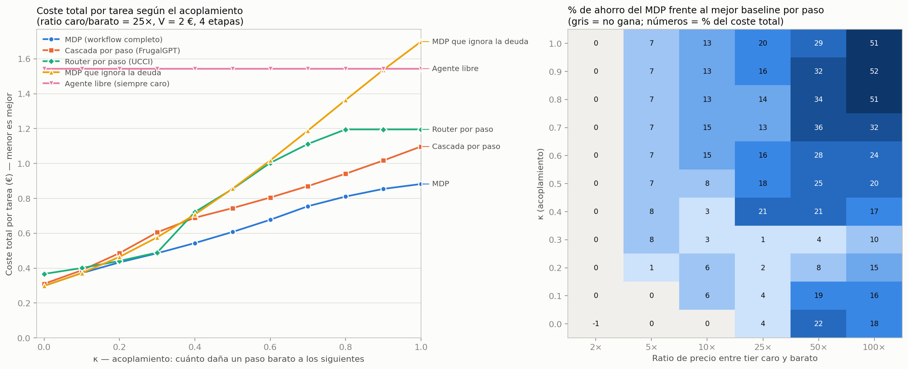

# Compiled Policies — success contract, benchmark, and kill test

> **Status (Sep 27, 2026):** three hypotheses tested. H1 rejected, H2 confirmed, and H3 post-hoc
> **not replicated** in the gate (§9). There is a golden corpus with 130/130 replay (`corpus/`). The architecture is consolidated in
> **`docs/adr/ADR-001-{FN,API,BE}.md`**, with the executable contract in `contracts/v1/`
> (`python contracts/validar.py`) and the retrospective in `docs/RETROSPECTIVE.md`.

Step 2 (diagnosis) of the framework of dynamically connected deterministic blocks.
Deliverables, all reproducible by seed:

| File | What it is |
|---|---|
| `contrato.py` | Success contract spec (Pydantic) + metrics |
| `benchmark/` | 120 synthetic tasks (4 levels; `extremo.py` with active traps) with seeded answers, deterministic verifiers, and self-test |
| `kill_test.py` | Simulation: MDP vs. cascade vs. router vs. free agent, with parity and optimality tests |
| `graficar.py` | Figure `resultados/kill_test.png` |
| `experimento_kappa.py` · `analizar_kappa.py` | Real experiment with LLMs (plan → gate → execution → verifier) and its analysis |
| `exp/` | Raw data: pilots, calibration, and the full experiment |
| `reutilizacion.py` · `benchmark/variantes.py` | H2: compiled blocks, policy variants, and routers |
| `comprobaciones.py` · `benchmark/deriva.py` | H3: data drift and runtime checks |
| `resultados/` | CSVs from all sweeps + figure |
| `docs/adr/` · `contracts/v1/` | ADR-001 (FN, API, BE) and the JSON Schema v1 contract with contract tests |
| `docs/RETROSPECTIVE.md` | Step 7: false assumptions, where time was lost, heuristics |
| `corpus/` | Golden corpus v1: 130 tasks with recorded events, artifacts, and calls; 130/130 replay |

```bash
pip install pydantic numpy pandas scipy matplotlib
python -m benchmark.generar --por-nivel 10 --extremo 30 --salida benchmark/out
python -m benchmark.verificar benchmark/out      # autotest
python kill_test.py --salida resultados          # ~10 s
python graficar.py resultados
```

---

## 1. Success contract

**Success** = the final state satisfies the workflow's postcondition, checked by a verifier
that is fixed *before* execution and that the executor cannot touch. Success is a state, not a piece of text.

Verifiers, from cheapest to most expensive (the contract validates that order):

| Type | Examples | Rule |
|---|---|---|
| `determinista` | schema, business rules, invariants, reconciliations, tests | tpr = 1, fpr = 0 |
| `estadistico` | calibrated classifier (Laya/Jev) with a threshold | requires `umbral`, declares tpr/fpr |
| `humano` | approval | expensive; calibrates the other two |

All must be `congelado=True`. In the benchmark, the target lives in a separate file and the task
carries its hash: if someone changes it, the verifier rejects it.

**Policy objective:** `R = V · 1[éxito] − coste`, where `V` = cost of the alternative
(human or expensive model). `λ = 1/V`.

**Main metric:** `coste total por tarea = E[coste] + (1 − P(éxito)) · V`.
It's what you spend plus what you pay the alternative when the framework fails.

> **Correction.** I previously proposed `€ por tarea resuelta = E[coste]/P(éxito)` as the main
> metric. The simulation ruled it out: with κ = 0, "always cheap" came out as the best
> (0.069 €/solved) with only 81% success, when its real cost per task was 0.44 € versus
> 0.30 € for the MDP. It doesn't charge for the alternative, so it rewards failing cheaply. It remains secondary.

**Reliability:** `pass^k` = fraction of tasks in which all k executions succeed.

---

## 2. Synthetic benchmark

| Domain | What is seeded | Target state | What increases with the level |
|---|---|---|---|
| `datos` | a pair of correlated variables + anomalous rows | `{"par", "anomalias"}` | rows (300→2000), variables (6→16), distractor pairs, weaker correlation |
| `negocio` | a batch of purchase requests + a 5-rule policy | per-request decisions + final budget per department (τ-bench style) | batch size (3→15), amount formats, VAT, threshold amounts, exhausted budget |

Deliberate traps in `negocio`: `413,23 + IVA` = 500.01 € → no longer "auto"; exact thresholds
(500.00 / 5000.01); a security exception and its near-exception (not urgent → rejected).

Guarantees (checked by the self-test):

- **Identifiable:** in `datos`, the ground truth is recalculated with the statement's own criterion and must
  match what was seeded (margin ≥ 0.10 in |r|); otherwise it is regenerated.
- **Sensitive verifier:** the 120 correct answers pass and the 360 perturbations
  (a missing/extra anomaly, a changed state, +1 € of budget…) fail.
- **Reproducible:** regenerating with the same seeds gives the same hashes.
- **Solvable:** a solver that only sees the visible inputs reaches the target in all 120 tasks.
- **Every branch of the policy shows up** at the medium, hard, and extreme levels.

Note: the tasks are deliberately well-defined, so a deterministic block (a script)
solves them for nearly 0 €. That is itself a test: a framework that doesn't pick that block
pays for it in cost.

---

## 3. Kill test (simulated)

**Question:** does optimizing the whole workflow (MDP) beat the best step-by-step
baseline? If not, the central thesis falls.

**Model** (every number is `[ASSUMPTION]`, they live in `Params` and can be changed):

- 4 stages in series, each with a deterministic verifier; 2 retries per stage.
- Cheap / medium / expensive tiers: local success rate 0.70 / 0.85 / 0.95; cost 1 : 5 : 25.
- **Debt:** a cheap step "passes," but leaves debt (φ = 0.5; medium 0.2; expensive 0) that lowers the
  success rate of the following stages: `P(ok) = d · q_tier · (1 − κ · deuda)`.
- **κ = coupling**: how much a cheap step damages the following ones. It is the
  gated-downshift thesis turned into a measurable number.
- Per-task difficulty `d ~ U(0,8; 1)`, unknown to the policies.

**Baselines** (all with their parameters tuned to their best value on the same tasks,
so they are optimistic):

- `cascada` — FrugalGPT style: moves up one tier per retry.
- `router` — UCCI style: the cheapest tier whose local probability clears a threshold τ.
- `mdp_sin_acopl` — an MDP that knows about retries but ignores debt.
- `agente_libre` — always the expensive tier + 30% overhead for deciding with the LLM.

**Controls:** exact (dynamic programming) vs. Monte Carlo agree (max |z| = 2.4). In its
own model the MDP never loses against another policy (margin ≥ 0).



### What comes out

MDP savings over the best baseline per step, at a 25× price ratio
(`resultados/resumen_ratio25.csv`):

| κ | Net-value view (V = 2 €) | Contract view (P ≥ 0.9, cheapest) |
|---|---|---|
| 0.0 – 0.3 | 1 – 4% | −20% to +42% (unstable) |
| 0.4 – 0.6 | 16 – 21% | 4 – 45% |
| 0.7 – 1.0 | 13 – 20% | 28 – 44% |

1. **Without coupling, and even at price ratios of up to 25×, there is no thesis.** With κ ≤ 0.3, a
   step-by-step cascade does almost the same (1–4%). The exception is ratios ≥ 50×: there the MDP
   wins 4–22% even without coupling, from how it spreads retries across tiers.
2. **With coupling, yes.** With κ ≥ 0.4 the MDP wins in both views. On the phase map it wins
   13–52% with κ ≥ 0.4 and ratio ≥ 25×. At a 10× ratio it takes κ ≥ 0.6 to reach 13–15%;
   at κ 0.4–0.5 it stays at 3–8%.
3. **The value is in measuring κ, not in "using an MDP."** An MDP that ignores debt loses to
   the cascade from κ ≈ 0.2 onward.
4. **With tiers of similar price (2×) there is nothing to optimize.**
5. **Sensitivity** (`sensibilidad.csv`, κ = 0.5):
   - misestimating κ (±) costs little: 16–18% of the savings;
   - but with κ = 0.2, underestimating it loses 5%;
   - with 2 stages the gain drops to 4%, with 8 it rises to 15%;
   - with V very low or very high it drops to 3–7%: there is only something to optimize when the
     cost/success trade-off is real.

### Weaknesses the simulation found

- **Planning with average difficulty makes the MDP unstable near p_min** (the "unstable"
  column). In reality this is a POMDP: each task's difficulty is revealed through its failures.
  The natural fix is to give a Laya/Jev-style classifier the role of **estimating each task's
  difficulty before starting** and using a context-dependent policy. That is exactly
  what a classifier does well.
- **The MDP lives right at p_min, so its pass^5 is lower** (0.6–0.76 versus 0.92 for the free
  agent). If reliability matters, it has to be in the contract: a higher p_min or a
  constraint on pass^k.
- Part of the advantage in the contract view comes from the MDP having more knobs to land
  right at p_min. A cascade with more configurations would shrink it.
- The phase map jumps because the baselines are families of rules and the best one changes from
  one cell to the next.

---

## 4. Kill criterion (quantitative)

Before building the engine:

1. **Measure effective coupling** δ = κ · φ_barato in a real workflow with ≥ 2 stages.
   Randomize the tier of stage s (cheap or expensive), fix the one for stage s+1,
   and compute
   `δ̂ = 1 − P(ok en s+1 | s barato) / P(ok en s+1 | s caro)`.
   Sample size per arm (α = 0.05, power 0.8), with a base success rate of 0.8: δ = 0.15 → 209;
   δ = 0.20 → 122; δ = 0.30 → 58.
2. **Know the real price ratio** between your tiers.
3. **Decide** with the phase map (φ_barato = 0.5, so κ = 2δ):

   | Price ratio | Build the MDP if… | If not |
   |---|---|---|
   | ≤ 5× | never (gain ≤ 8%) | cascade |
   | 10× | δ̂ ≥ 0.3 (κ ≥ 0.6) | cascade |
   | 25× | δ̂ ≥ 0.2 (κ ≥ 0.4) | cascade |
   | ≥ 50× | almost always (4–52%) | — |
4. **Confirm on the real benchmark:** MDP vs. best per-step baseline, on total cost per task
   and with a 95% bootstrap CI. **It is rejected if the lower bound of the improvement's CI is < 5%.**

---

## 5. Real pilot (`experimento_kappa.py`, `exp/`)

Minimal replica of gated-downshift in 2 stages: **plan** (randomized tier: Haiku 4.5 or Opus 5.5)
→ **deterministic gate** (full plan) → **execution** with a fixed tier, Haiku, which writes a
program → benchmark **verifier**. Paired design: per task, the two plans plus a **no-plan**
arm, all with the same executor. `medium` effort on every call.
Real cost per call (the CLI's list price).

```bash
python experimento_kappa.py --tareas 12 --reps 1 --salida exp/piloto_v2 --presupuesto-usd 5
python analizar_kappa.py exp/piloto_v2
```

**12 tasks (6 per domain, 2 per level), 1 replicate — `exp/piloto_v2/resumen.json`:**

| Arm | Success | Avg. cost | Total cost per task (V = 2) |
|---|---|---|---|
| no plan | 12/12 | 0.045 $ | **0.045 $** |
| expensive plan (Opus) | 12/12 | 0.138 $ | 0.138 $ |
| cheap plan (Haiku) | 10/12 | 0.087 $ | 0.420 $ |

- **Ceiling:** the cheapest executor, with no plan, solves the whole benchmark. As it stands it
  isn't useful for measuring δ; it has to be hardened until "no plan" succeeds 50–70% of the time.
- **δ̂ = 0.17, 95% CI [0; 0.42], McNemar p = 0.5.** The only 2 failures come with the cheap plan (there are
  none with no plan or with the expensive plan). It points in the direction of debt, but with n = 12 it isn't
  significant.
- **The effective cost ratio of Opus/Haiku per planning call ≈ 3×, not 25×.** Haiku spends more tokens.
  On the phase map, ≤ 5× means an MDP between Haiku and Opus doesn't beat a cascade. **The
  decision that does have a high ratio is whether to plan at all** (0 $ versus 0.14 $). That one is
  handled well by a per-task classifier.
- **Benchmark bug found and fixed:** the policy said "unapproved vendor" but the task didn't
  provide the list. The executor with the expensive plan caught it and failed loudly; the
  others guessed. A **solvability test** was added to the self-test: a solver that only sees the
  visible inputs has to reach the target. With the list removed, the test reproduces
  the pilot's failure exactly. Pilot v1 (`exp/piloto`) stands as a record; only its
  `datos` portion is valid.

Total spend on pilots and tests: ≈ 6.4 $ (list price).

---

## 6. Full experiment — extreme level (`exp/completo`)

**Hardening** (`benchmark/extremo.py`, 30 tasks per domain). Each trap is checked to be
active at generation time (skipping it changes the answer) and every task passes the solvability test:

- **datos:** duplicate ids (keep the first), blanks, columns with > 20% blanks
  excluded from the pair (including a highly correlated decoy), anomalies by region, decimal
  commas in some values, and a column with MAD = 0.
- **negocio:** an unordered batch, amounts in USD/GBP with Anglo-Saxon formatting, cancellations that
  return budget, and splitting (summing 7 days to pick the approver).

Calibration with the no-plan arm: 5/6 in each domain (targeting 50–70%; accepted to avoid
spending more). Verifier tolerance raised to 5 cents for rounding differences.

```bash
python experimento_kappa.py --tareas 60 --reps 1 --niveles extremo --salida exp/completo --presupuesto-usd 27 --hilos 8
python analizar_kappa.py exp/completo
```

**60 tasks (30 + 30), 1 replicate, paired design:**

| Arm | Success (datos) | Success (negocio) | Overall success | Avg. cost | Total cost per task (V = 2 $) |
|---|---|---|---|---|---|
| no plan | 26/30 | 18/30 | 73% | 0.082 $ | 0.616 $ |
| cheap plan (Haiku) | 25/30 | 18/30 | 72% | 0.125 $ | 0.692 $ |
| **expensive plan (Opus)** | 29/30 | 27/30 | **93%** | 0.201 $ | **0.334 $** |

- **The coupling is real and significant.** δ̂ = 0.23, 95% CI [0.11; 0.36], McNemar p = 0.002
  (15 pairs favoring the expensive plan, 2 against).
  - In negocio: δ̂ = 0.33 [0.12; 0.52], p = 0.012.
  - In datos: δ̂ = 0.14 [0; 0.29], not significant.
  - Translated to the simulation's κ: κ ≈ 0.46 overall and ≈ 0.67 in negocio.
- **The debt doesn't show up locally.** Both tiers pass the gate 100% of the time. The cheap plan
  is "complete" but omits cases. Real example: it specifies currencies by code and the executor
  crashes on "265,47 €". In negocio, 9 of the 12 failures with the cheap plan are programs that
  crash (8 of 12 with no plan; 1 of 3 with the expensive plan).
- **A cheap plan is worse than no plan at all.** It succeeds at the same rate as no plan (72% versus 73%),
  but costs more. It confirms with data the gated-downshift thesis: downgrading the planner's model
  doesn't save money, it just shifts the cost.
- **Planning with Opus wins on total cost in both domains.**
  - Versus no plan: −0.28 $ per task, 95% CI [−0.54; −0.03].
  - Versus the cheap plan: −0.36 $, 95% CI [−0.62; −0.12].
  - Skipping the plan would only pay off if the alternative cost less than ≈ 0.9 $ (datos) or
    ≈ 0.5 $ (negocio).
- **Effective cost ratio of Opus/Haiku per call: 3.2×.**

### Verdict of the kill criterion

For choosing between **Haiku and Opus when planning, the dynamic thesis falls**. The ratio (3.2×) sits in the
"≤ 5× → never" zone of the phase map, and the data confirms it: there is a fixed policy that dominates
(always plan with Opus). A per-domain router gains 0% because Opus is the best in both domains.
An MDP would converge to that same fixed rule.

**What survives:** the coupling is real (κ ≈ 0.5–0.7). Deciding by looking at downstream cost,
rather than the local one, is correct. But with a small price ratio, that decision gets made once and
frozen.

**Next hypothesis (high ratio, untested):** the executor rewrites the program on every task
for 0.07–0.11 $. A validated, reused block costs ≈ 0. The decision with ratio → ∞ is "is this
covered by an already-compiled block, or does it need generating?", and it's a classification task, the natural role of
Laya/Jev. Proposed kill criterion: the fraction of tasks covered by reused blocks
times the savings has to outweigh the cost of the failures on the uncovered ones.

Limitations: 1 replicate per task; fixed executor (Haiku 4.5); `medium` effort; synthetic
tasks; a minimal replica of gated-downshift, not the real plugin; V = 2 $ assumed.

Spend on this phase: calibration 1.30 $ + experiment 24.50 $ (list price).
Project total to date: ≈ 32 $.

---

## 7. H2: reusing compiled blocks (`reutilizacion.py`)

**Hypothesis.** The high-ratio decision isn't Haiku versus Opus, it's this one: is the task covered by
an already-compiled, validated block (≈ 0 $) or does a program need to be generated (≈ 0.2 $)?

**What already exists:** LATM (ICLR 2024) proposes an expensive tool maker, a cheap user, and a
lightweight *dispatcher* that is right 95–96% of the time when deciding whether a cached tool
works. There's also Compiled AI (2026). What is tested here and they don't cover is **policy
drift**: tasks that closely resemble the block's but change one rule, where reusing it
gives a wrong answer **without warning**.

**Design.**

- One block per domain: Opus plans it, Haiku writes the program, and it's validated on 5 training
  tasks (extreme, seeds 0–4).
- Test flow per domain:
  - 25 tasks with the identical policy (extreme 5–29);
  - 10 **cosmetic** ones: same logic, worded differently (lightly and heavily);
  - 10 **substantive** ones: thresholds, VAT/window, a rule change without touching numbers, a category.

  Each substantive variant genuinely changes the answer for its instance (checked at generation time).
  `benchmark/variantes.py`: 60/60 parity with `extremo.py`'s engines.
- Policies:

  | Policy | How it decides |
  |---|---|
  | always generate | results from `exp/completo`, Opus-plan arm, for the 25 identical tasks |
  | always reuse | uses the block on every task |
  | **hash** router | reuses only if the policy text is identical |
  | **numeric-signature** router | reuses if the numbers and quoted terms match |
  | **semantic** router | hash first; if it differs, Haiku judges whether the logic is equivalent (p ≥ 0.8) |

**Kill criteria, fixed BEFORE running:**

- **K1 (reuse).** The best router has to lower total cost per task by ≥ 30% versus
  "always generate," losing at most 2 points of success rate. If not, H2 falls.
- **K2 (System-1).** The semantic router has to lower total cost by ≥ 5% versus the best
  deterministic router **and** not have more silent failures. If not, a classifier doesn't earn
  its place: a deterministic contract is enough.

Results are given for this mix (56% identical / 22% cosmetic / 22% substantive) and
for other mixes, by reweighting per category.

```bash
python -m benchmark.variantes --n-cosm 10 --n-sust 10 --salida benchmark/out
python reutilizacion.py compilar && python reutilizacion.py evaluar --presupuesto-usd 13 && python reutilizacion.py analizar
```

### Results (90 tasks, `exp/reutilizacion/resumen.json`)

Both blocks validated on the first try: 5/5 in training, with a compilation cost of
0.11 $ (datos) and 0.26 $ (negocio), amortized over the cost of each task.

| Policy | Reuse rate | Success | Avg. cost | Total cost per task (V = 2 $) | Silent failures | Vs. always generate |
|---|---|---|---|---|---|---|
| always generate | 0% | 93.3% | 0.199 $ | 0.333 $ | 0 | — |
| always reuse | 100% | 77.8% | 0.004 $ | 0.449 $ | **20** | +35% |
| hash router | 56% | 96.7% | 0.092 $ | 0.159 $ | 0 | −52% |
| numeric-signature router | 79% | 91.1% | 0.050 $ | 0.228 $ | **6** | −32% |
| **semantic router** | 78% | **100%** | 0.054 $ | **0.054 $** | 0 | **−84%** |

- **K1: passes.** The semantic router lowers total cost by 84% and raises success (100% versus 93%).
- **K2: passes.** The semantic router costs 66% less than the best deterministic one (hash) and has no
  silent failures.
- **A validated block is more reliable than regenerating.** It gets 50/50 on the identical tasks and 20/20 on the
  cosmetic ones. Regenerating gets 47/50 and 17/20: every regeneration is a new chance to
  introduce a bug. A fixed program has pass^k = 1.
- **Judge (Haiku, ≈ 0.014 $ per call): 40/40.** The cosmetic ones come out with p ≥ 0.95 and the
  substantive ones with p ≤ 0.08. The margin is huge.
  - **Hash:** it's safe, but it regenerates all 20 cosmetic ones.
  - **Numeric signature:** it silently reuses the 6 variants that change the logic without touching
    numbers or quoted terms (anomaly scope, keep first/last duplicate, cancellation
    without a refund), and it also regenerates 5 cosmetic ones.
- **The threshold comes from the costs.** Reusing pays off if (1 − p) · V < c_gen + (1 − q_gen) · V,
  i.e., p > 1 − (0.20 + 0.07 · 2) / 2 ≈ 0.83. The chosen 0.8 is close to that. This is where it matters
  that the classifier's probability be calibrated.

Total cost per task by the flow's mix (identical / cosmetic / substantive):

| Mix | always generate | hash router | semantic router |
|---|---|---|---|
| 90 / 5 / 5 | 0.323 $ | 0.039 $ | **0.015 $** |
| 56 / 22 / 22 (this one) | 0.333 $ | 0.159 $ | **0.054 $** |
| 20 / 40 / 40 | 0.342 $ | 0.282 $ | **0.094 $** |
| 0 / 50 / 50 | 0.348 $ | 0.352 $ | **0.116 $** |

If almost everything repeats (90/5/5), the hash already captures most of the savings and the judge adds
0.024 $ per task. The more wording variation there is, the more the judge contributes.

### Verdict

**H2 survives, and this is where the framework truly wins.** The high-ratio decision is "is this covered by
a validated block?" A hash → cheap judge → generate cascade lowers total cost by 84% and raises
success to 100% in this flow. Jev/Laya's role is now defined: the classifier that decides
coverage with a calibrated probability. No MDP is needed for this; it's a one-step decision with
a threshold set by the costs.

**Honest limits:**

- The substantive variants are written into the policy text. Real drift could be
  more subtle: new data formats, referenced tables that change, or implicit rules.
  The judge's 40/40 is an upper bound for the drift that is visible in the text.
- In production there is no verifier holding the correct answer. Failures of the block on
  new inputs have to be caught by runtime invariants (the success contract's verifiers).
- The judge is Haiku, not Laya/Jev. Laya's English checkpoint supports 512 tokens and the judge's
  input (the two policies) runs about 500–1,100, so it would need the multilingual version or a fine-tune
  with labeled pairs like these.
- 10 cosmetic and 10 substantive variants per domain: a small n for the tails.

Spend on this phase: compilation 0.37 $ + generating variants 7.91 $ + judge 0.57 $ = 8.85 $.
Project total to date: ≈ 41 $ (list price).

---

## 8. H3: data drift and runtime checks (`deriva.py`, `comprobaciones.py`)

**Hypothesis.** The policy doesn't change (the hash says "reuse"), but the DATA does: new months,
amounts of a different magnitude, larger batches, a CSV exported with ';', etc. The block can fail
**without warning**. Can cheap checks, without knowing the answer, catch those failures?

**What already exists (and gets integrated):**

- **Input profiling** in the style of TensorFlow Data Validation: a schema is inferred from the inputs
  the block was validated on, and anything outside it is treated as untested territory.
- **Disagreement between independent versions** (N-version programming; in LLMs, "incoherence,"
  AAAI): if two independently generated programs give different outputs, at least one is wrong.
  It catches about 2/3 of errors; the rest are correlated failures.
- **Output invariants** from the contract: structure, ids, valid states, budgets.

**Drift types, fixed BEFORE looking at the blocks' code** (5 tasks per type, ground truth
computable from what's visible):

| Domain | Drift | What changes |
|---|---|---|
| negocio | N1 month change | dates move from September to October; the 7-day window crosses the month boundary |
| negocio | N2 large amounts | millions with various thousands separators (1.234.567,89 € / 1,234,567.89 USD) |
| negocio | N3 large batch | ~110 requests, 3-digit ids |
| negocio | N4 new department and vendor | "legal" in budgets and a new approved vendor |
| datos | D1 thousands separator | values with decimal comma and thousands period (1.234,567) |
| datos | D2 new region | a "centro" region with few rows |
| datos | D3 CSV with ';' | European export: ';' separator and decimal commas throughout |
| datos | D4 text column | a non-numeric "comentario" column |

**Kill criteria, fixed BEFORE running:**

- **K3a (safety).** Some combination of checks catches ≥ 80% of the block's wrong answers
  on the drift tasks, with ≤ 10% false alarms on the normal ones.
  If none achieves that, reusing under data drift isn't safe without supervision.
- **K3b (economics).** With that combination, on a 50/50 normal/drift mix, the total cost per
  task is ≥ 30% lower than "always generate."

Failures that crash outright (an exception, output that isn't JSON) are always detected and go to
generate; what matters is the silent ones.

```bash
python -m benchmark.deriva --por-tipo 5 --salida benchmark/out
python comprobaciones.py compilar_b && python comprobaciones.py evaluar --presupuesto-usd 12 && python comprobaciones.py analizar
```

### Results (90 tasks: 50 normal + 40 with drift, `exp/deriva/resumen.json`)

**What the block does under drift:**

- It holds up on 6 of 8 types without a single failure: month change, millions, a batch of 126,
  new department and vendor, new region, text column.
- D3 (CSV with ';') always crashes. It's detected and regenerated, 5/5 correct.
- **Only D1 (thousands period) produces silent errors: 2 of 5.** An anomaly is missed because
  "8.215,910" isn't parsed correctly.

**What each check detects:**

| Check | Detection of silent errors | False alarms on normal tasks |
|---|---|---|
| Output invariants | 0% (the wrong output is structurally valid) | 0% |
| N-version (a second block from the same pipeline) | **0%**: it makes exactly the same error on D1 | 0% |
| 5-task profile (pre-registered) | 100% | **34%** (legitimate formats that didn't appear in the 5 tasks) |
| 30-task profile [post-hoc] | 100% | 0% |

The N-version case is a **correlated failure**, exactly what the literature warns about: two
samples of the same process aren't independent.

**Result of each end-to-end policy:**

| Policy | Normal success | Drift success | Wrong deliveries with no warning | Escalated to human | 50/50 total cost | Vs. generate |
|---|---|---|---|---|---|---|
| reuse (only on crash) | 100% | 95% | 2 | 0 | 0.067 $ | −81% |
| + invariants / + N-version | 100% | 95% | 2 | 0 | 0.067 $ | −81% |
| + 5-task profile (pre-registered) | 96% | 92.5% | 3 | 0 | 0.278 $ | −19% |
| + 30-task profile [post-hoc] | 100% | 92.5% | 2 | 0 | 0.194 $ | −44% |
| **+ 30-task profile → cross-check → human** [post-hoc] | 100% | 92.5% | **0** | 3 | 0.194 $ | −44% |
| always generate | 94% | 92.5% | 4 | 0 | 0.346 $ | — |

- **Detecting isn't enough, because plan B fails too.** Regenerating succeeds 92.5% of the time under drift,
  less than the block itself (95%). If the profile routes to regeneration, silent errors don't
  drop: they just move (the block's 2 become the regeneration's 2).
- **What did work [post-hoc]: cross-checking.** On a profile alarm, a new program is generated and
  compared against the block. That program sees the new format, so it's genuinely diverse.
  If they agree, it's delivered; if not, it goes to a human. Result: 0 wrong deliveries and
  3 of 40 drift tasks escalated, at the same cost as the profile alone.

### Verdict

**With the pre-registered setup, K3a doesn't pass, so neither does K3b.** The 5-task profile gives 34%
false alarms, and the invariants and N-version detect 0%. The 30-task profile passes K3a
and K3b (−44%), and cross-checking eliminates silent errors. But **both were decided
by looking at this data**: they need to be pre-registered and confirmed with fresh drift before
being trusted.

**Design lessons (the ones that don't depend on post-hoc tuning):**

1. A block's domain of validity is inferred from a fair amount of normal data; 5 examples
   produce a profile that is too narrow.
2. The diversity that catches errors has to come from **different information** (a program that
   sees the new input), not from resampling the same process.
3. Plan B isn't an oracle: when the block and plan B disagree, it escalates.
4. The trade-off is made explicit. Reusing blindly is 3 times cheaper, with 5% silent
   errors on drift tasks. Cross-checking costs more on those tasks, but
   delivers nothing wrong.

**Limits:**

- 8 drift types and 5 tasks per type.
- Only 2 silent errors from the block: too small an n to measure detection.
- Invisible semantic drift (same format, different meaning) isn't caught by any profile;
  it needs business signals or a human.

Spend on this phase: block B 0.38 $ + evaluation 9.17 $ (including redoing D3 after
fixing the CSV-with-';' description) ≈ 9.55 $. Project total to date: ≈ 51 $ (list price).

---

## 9. Golden corpus and H3 gate (`corpus/`)

With the design already fixed in ADR-001 (RN3 threshold = 0.8337, 30-example profile, cross-
check, and human) 130 tasks were recorded with all their artifacts:

- **398/398 valid instances** against contract v1.
- **Identical 130/130 replay** with no calls (0 $).
- Recording cost: 13.19 $.

| Group | Decisions | Wrong deliveries | Total cost per task (V = 2) |
|---|---|---|---|
| Normal (50) + variants (40) | 70 reuse · 18 generate · 2 unresolved | **0 of 88** | 0.094 $ |
| With drift (40) | 29 cross-check · 5 generate · 6 escalate | **2 of 34** | 0.619 $ |

**The H3 gate fails:** 2 wrong deliveries (target 0) and 15% escalations (target
≤ 10%). Under drift it costs more than reusing blindly (0.125 $) and than always generating (0.371 $),
with the same error rate as reusing blindly (2 of 40).

The gaps and the H4 proposal ("drift = recompile the block with the alarm's reasons and 3–5
labeled cases") are in ADR-001-BE, "RN7 status."

Project total to date: ≈ 64 $ (list price).

## 10. Open assumptions

`[ASSUMPTION]` Per-tier success and debt, a multiplicative form of coupling, a
perfect verifier at each stage, a linear chain (no branches or parallelism), uniform difficulty, prices.
Next iteration:

- an imperfect statistical verifier (Laya) on the ladder;
- parallel branches with shared resources;
- a context-dependent policy with estimated difficulty.

## 11. H2 with Jev as coverage judge (`juez_jev.py`, `exp/jev_juez/`)

Question: can Jev (TypeSafe, `typesafe/jev-1.13` via OpenRouter's Decisions API) take
Haiku's place in §7's hash → judge → generate cascade? The same 40 variants whose text differs
from the block (10 cosmetic and 10 substantive per domain, from `exp/reutilizacion/evaluacion.jsonl`),
the `SISTEMA_JUEZ` question turned into a yes/no decision by Jev, and the semantic router's threshold:
reuse if p ≥ 0.8. Benchmark: Haiku got 40/40 (0 substantive variants reused, 0 equivalents
regenerated) at a judge cost of 0.57 $.

**Kill criterion (written 2026-09-27, before running):** Jev dies as a judge if it reuses
any substantive variant (a silent failure: reusing a block that no longer applies) or if it regenerates
more than 2 of the 20 equivalents. If it survives, the cascade's judge costs on the order of 0.0001 $
per query `[ASSUMPTION]` instead of ~0.014 $. Expected spend: < 0.01 $.

### Verdict (2026-09-27, `exp/jev_juez/resumen.json`)

**Jev survives as judge.** 40/40, same as Haiku: 0 substantive variants reused and 0 equivalents
regenerated. Judge cost 0.0020 $ versus 0.570 $ (≈ 287× less); median latency 0.31 s. The
separation is wide: cosmetic variants land at p 0.95–0.97 and substantive ones at 0.02–0.04, far from the
0.8 threshold. Hashes of the script and of the prior evaluation are in the summary.

**Honest limits:** the same as Haiku's 40/40 in §7 (variants written into the policy text, n = 40,
an upper bound on drift visible in the text). Also, in another project a Jev filter that
passed a synthetic battery died with real data (repo `memoria`, H005), so before putting it in
the production cascade it needs to be measured against real variants. Plugging it in changes the pipeline's judge:
per ADR-001-BE the judge is swappable, but `corpus/v1/`'s replay compares prompts.

Spend on this phase: 0.002 $.

## 12. H5: reusing with parameters (`reutilizacion_parametros.py`, `exp/parametros/`)

Idea taken from Agentic Plan Caching (arXiv 2506.14852; see `docs/PRIOR-ART.md`): split the
block into logic + parameters so it can also be reused when the policy changes only in values.
Today the 20 substantive variants are regenerated wholesale.

New cascade: identical text → equivalence judge (§7) → **do only the parameters change?** → generate.
1. **Parametrize** (once per domain, Opus): given ONLY the base policy and the validated block from
   `exp/reutilizacion/` — no variant — rewrite it with a `PARAMS` dictionary whose default values reproduce
   the current behavior. Parity: with default values it has to give the
   same result as the original block on the domain's 35 identical and cosmetic tasks, run
   on this machine. Up to 2 attempts per domain; a domain without parity is left without parameters.
2. **Extract** (per task, Haiku): given policy A, the parameter schema, and policy B, decide
   whether B follows from A by changing only parameters, and give the new values. If so,
   run the parametrized block with those values; if not, generate (result and cost recorded in §7).

**Kill criterion (written 2026-09-27, before running):** H5 dies if (a) any parametric reuse
produces an incorrect result (a silent failure), or (b) it covers fewer than 5 of the 20
substantive variants, or (c) the new cascade's average total cost (V = 2 $ per failure, compilation and
parametrization amortized per domain, as in §7) doesn't drop at least 10% versus §7's semantic
router. Budget: 4 $, calibrating first with one domain.

Environment for this run (Windows, local `.venv` with pandas 2.3.3, `PYTHONUTF8=1`): replaying the
golden corpus gives 103/130; the 27 discrepancies are prompts from data variants (pending in the
dependencies bead). That's why parity and the original block's baseline are run on this same machine.

### Verdict (2026-09-27, `exp/parametros/resumen.json`)

**H5 survives.** Baseline on this machine: the original block gets 35/35 on each domain's control,
matching the recorded run. Opus parametrized both domains on the first attempt with 35/35 parity (negocio,
16 parameters; datos, 12) without seeing a single variant, and the parameters it exposed cover all 8 types of
substantive change. Haiku flagged all 20 substantive variants as "parameters only" and all 20 ran correctly.

| | semantic router (§7) | + parameters (§12) |
|---|---|---|
| substantive variants reused | 0/20 | 20/20 |
| silent failures | 0 | 0 |
| success (90 tasks) | 100% | 100% |
| average total cost per task | 0.054 $ | 0.015 $ (−72%) |

Spend: parametrizing 0.227 $ + extracting 0.175 $ = 0.40 $ (versus 3.92 $ to regenerate all 20).

**Limit that decides the next step:** the 20 substantive variants in the benchmark are, by construction,
parameter changes from the generator (`benchmark/variantes.py`). None of them added a rule the
schema can't express, so the most dangerous case wasn't measured: the extractor saying "parameters
only" for a genuinely new rule, which would be a silent failure. In the `memoria` repo a filter that
passed a synthetic battery died with real data (H005). Before using H5 in production: variants with
new rules, where the extractor has to answer "no."

### 12.1 Negative case: rules the schema can't express (`negativos_parametros.py`)

12 hand-written variants on the base policy (6 per domain), each with something none of
the 28 parameters can express: new rules, traps that look like a parameter (a fourth approval
level, a per-category or per-column threshold, "at least two values"), and two mixed ones (a legitimate
parameter change plus a new rule). Same extractor (Haiku, `SISTEMA_EXTRAER`) and the same
parametrized blocks from §12, untouched.

**Kill criterion (written 2026-09-27, before running):** H5 isn't ready for production if the
extractor answers "parameters only" on **any** of the 12: every "yes" would be a silent failure
(reusing a block that doesn't implement the new rule). Known limit: they were written by Claude, who knew
the schema; they aren't real changes from a business. Budget: 0.5 $.

**Verdict (2026-09-27, `exp/parametros_negativos/resumen.json`): H5 holds.** The extractor answered
"no" on all 12, including the four that look like a parameter and the two mixed ones, and in each case named
the rule the schema doesn't cover. Cost 0.108 $. Combined with §12: 20/20 correct "yes" and 12/12 correct "no."

**What's still needed before production:** real policy changes (or ones written by someone who can't see
the schema), and a shadow phase: decide with H5, generate anyway, and compare, before trusting the reuse.